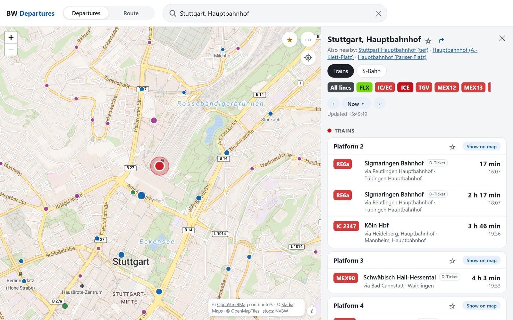
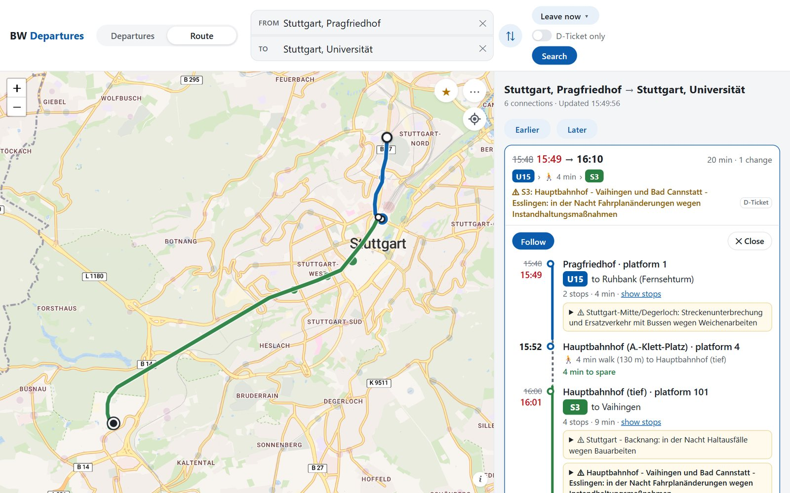
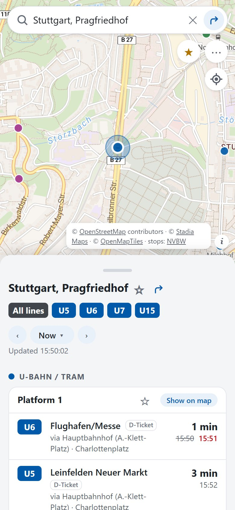
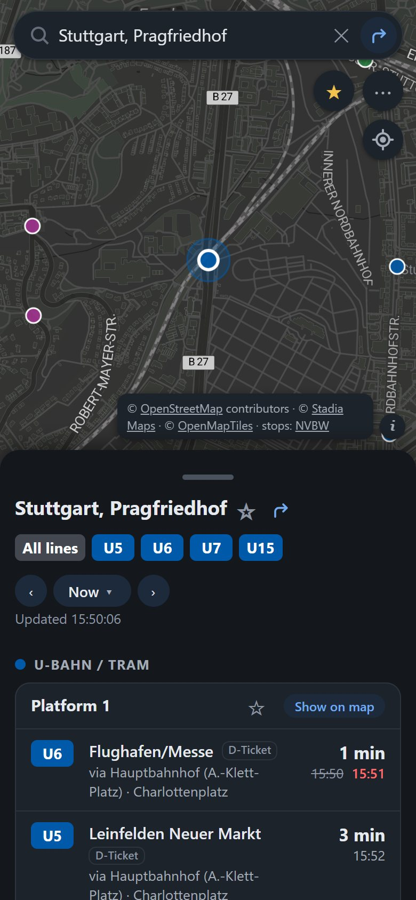
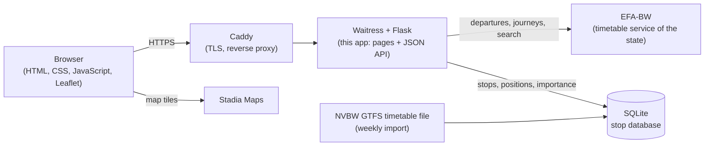

# BW Departures

A live departure board and journey planner for public transport in Baden-Württemberg, Germany:
pick a stop on the map or search for one, and see its next departures grouped by transport mode
and platform, with live delays and cancellations. Plan a journey between stops, addresses or
your location, and follow it: the app keeps checking the connection and offers new ones when a
delay breaks a change or a ride is cancelled.

**Live: [bw-departures.duckdns.org](https://bw-departures.duckdns.org)** (works on phones, tablets and laptops)



| A journey with its route on the map | On a phone (light and dark) |
|---|---|
|  |   |

## Features

**Departures**
- Map of all 29,000+ stops in the state, coloured by transport mode; zoomed out, it shows the most important station of each area.
- Search that forgives typos and missing umlauts ("Mulhausen", "Stutgart Hbf") and prefers stops near the part of the map you are looking at.
- Departures grouped by mode, then by platform, with live delays (planned time crossed out, new time in red), cancellations, the main stops on the way, Deutschlandticket and replacement-bus labels.
- Tap a departure to see all its stops and where its platform is on the map.
- Line filter ("only my U6"), departures at any chosen date and time, favourite stops and platforms, recently opened stops.
- Every stop has its own address (`/stop/de:08111:6115`), the browser's Back button works step by step, light and dark mode, two layouts on phones.

**Journey planner**
- From and to: stops, streets, addresses, sights or your current location; leave at or arrive by; "Deutschlandticket only".
- Connections with every ride, walk and change, the route drawn on the map, and operator notices (construction, replacement buses).
- **Follow** a connection: every 30 seconds the app checks each ride's live times; when a delay makes a change impossible or a ride is cancelled, it says so and offers new connections from where you will be.

## How it works



- The **browser** runs a plain JavaScript client (no framework, no build step) that only talks to the app's own JSON API.
- The **backend** (Python, Flask) asks the state's timetable service (EFA) for departures and journeys, turns its large and inconsistent answers into clean, small JSON, and caches them briefly so many visitors don't multiply the requests.
- A **stop database** (SQLite), built from the official timetable file of NVBW, knows every station, its platforms, position and importance. It powers the map, the search and the choice of the "via" stops.
- The **JSON API** (`/api/v1`) is documented in [docs/API.md](docs/API.md) and kept stable: within v1, fields are only ever added.

## Tech stack

| Part | What | Why |
|---|---|---|
| Backend | Python 3, Flask, requests | Small, explicit framework; the app is mostly an adapter between an outside service and a JSON API |
| Data | SQLite (Python's standard library) | One file, no database server; read-mostly data rebuilt from the timetable file each week |
| Frontend | HTML, CSS, JavaScript, Leaflet | No build step; fast on phones; Leaflet for the map |
| Server | Waitress behind Caddy, systemd, Ubuntu (Strato VPS) | One process with shared in-memory caches; Caddy handles HTTPS certificates automatically |
| Quality | unittest, GitHub Actions, Playwright browser tests | 370 unit tests run on every push (Python 3.11 and 3.12), without network access |
| Operations | `bw-update`, self-check, Healthchecks.io | Updates run the tests first and roll back by themselves if the new version is unhealthy |

## Project structure

```
app.py               pages, security headers, compression; wires everything together
serve.py             the production server (Waitress), settings from .env
api/                 the JSON API (v1), the journey planner's part, per-visitor rate limits
efa/                 the timetable service: HTTP client with caching, and parsing of its answers
services/            departure boards, stop search index, journeys
gtfs/                building and reading the stop database
import_stops.py      download the NVBW timetable file and build data/stops.sqlite
templates/, static/  the page: HTML, CSS, one JavaScript file per part (map, departures, route, ...)
tests/               unit tests (no network)
docs/API.md          the API documentation
deploy/              the server setup: Caddy, systemd units, the update script, a step-by-step guide
selfcheck.py         the server's regular health check
```

## Run it locally

Needs Python 3.10 or newer.

```bash
git clone https://github.com/muhammad-guluzade/BWDepartures.git
cd BWDepartures
python -m venv .venv
source .venv/bin/activate        # Windows: .venv\Scripts\activate
pip install -r requirements.txt
python import_stops.py           # downloads the timetable file (about 55 MB) and builds the stop database, about a minute
python app.py                    # http://localhost:5000
```

Tests: `python -m unittest`. The journey planner can be switched off with `BW_NAVIGATOR=off`
(see [.env.example](.env.example)). How the public server is set up and updated:
[deploy/README.md](deploy/README.md).

## Data and credits

- Stop data: Datensatz der NVBW GmbH ([nvbw.de/open-data](https://www.nvbw.de/open-data)), licence [dl-de/by-2-0](https://www.govdata.de/dl-de/by-2-0).
- Departures, live data and journeys: the EFA timetable service of Baden-Württemberg (efa-bw.de).
- Map: © [Stadia Maps](https://stadiamaps.com/) © [OpenMapTiles](https://openmaptiles.org/) © [OpenStreetMap](https://www.openstreetmap.org/copyright) contributors; [Leaflet](https://leafletjs.com/).
- Tab icon: German bus stop sign (Zeichen 224), public domain, via Wikimedia Commons.

This is an independent student project, not affiliated with NVBW, the transport operators or Deutsche Bahn.

## Author

Muhammad Amin Guluzade, M.Sc. Computer Science student at the University of Stuttgart
([LinkedIn](https://linkedin.com/in/amin-guluzade)).

## Licence

The code is under the [MIT licence](LICENSE). The data and map credits above have their own terms.
